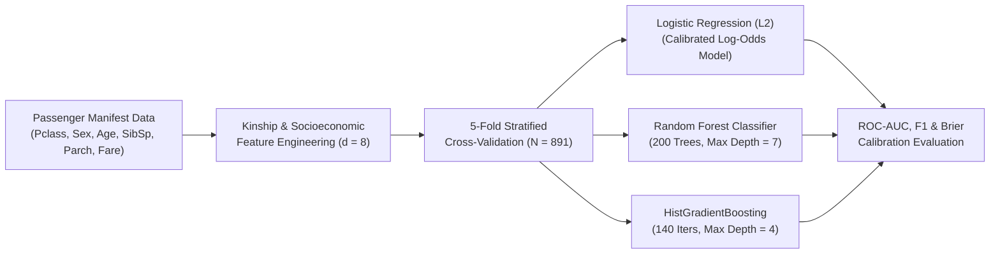
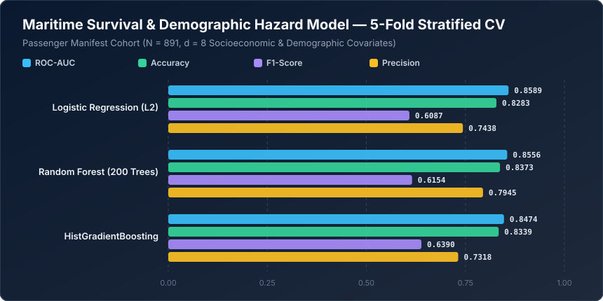

# Maritime Survival & Demographic Hazard Model


A probabilistic hazard and survival classification framework modeled on the **RMS Titanic passenger manifest ($N = 891, d = 8$)**. This repository investigates how socioeconomic stratification (`Pclass_Cabin_Tier`, `Ticket_Fare_GBP`), demographic priority protocols (`Sex_Female_Indicator`, `Age_Years`), and kinship network size (`SibSp_Count`, `Parch_Count`, `Is_Traveling_Alone`) govern evacuation survival probabilities and Brier calibration accuracy.

---

## Demographic Hazard Modeling Pipeline



---

## Mathematical Formulation

### 1. Stratified Evacuation Log-Odds Specification
Let $Y_i \in \{0, 1\}$ denote passenger survival. Under the evacuation protocol (*"women and children first"*, modulated by deck access across cabin tiers $C_i \in \{1, 2, 3\}$ and large-family coordination penalties $F_i = \text{SibSp}_i + \text{Parch}_i + 1$), the conditional survival probability $p_i = P(Y_i = 1 \mid \mathbf{x}_i)$ follows the logistic link:

$$\text{logit}(p_i) = \ln\left(\frac{p_i}{1 - p_i}\right) = \beta_0 + \beta_S \text{Female}_i - \beta_C (C_i - 1) + \beta_{\text{child}}\mathbb{I}(\text{Age}_i < 12) - \beta_F \max(0, F_i - 4) + \beta_{\text{fare}}\ln(1 + \text{Fare}_i)$$

### 2. Probabilistic Calibration via Brier Score Decomposition
Beyond thresholded classification accuracy, probabilistic hazard models are evaluated by the **Brier Score** ($\text{BS}$), which measures mean squared probability calibration error:

$$\text{BS} = \frac{1}{N} \sum_{i=1}^{N} \left(\hat{p}_i - y_i\right)^2$$

Lower Brier scores indicate superior alignment between predicted survival probabilities $\hat{p}_i$ and empirical evacuation frequencies.

---

## Quantitative Benchmark Results

Evaluated via **5-Fold Stratified Cross-Validation** across $N = 891$ passenger records and 8 manifest features.



| Rank | Hazard Classification Model | ROC-AUC | Accuracy | F1-Score | Precision | Recall | Brier Score ($\downarrow$) |
| :--- | :--- | :---: | :---: | :---: | :---: | :---: | :---: |
| **1** | **Logistic Regression (L2)** | **0.8589** | 0.8283 | 0.6087 | 0.7438 | 0.5152 | **0.1218** |
| **2** | **Random Forest (200 Trees)** | 0.8556 | **0.8373** | 0.6154 | **0.7945** | 0.5022 | 0.1231 |
| **3** | **HistGradientBoosting** | 0.8474 | 0.8339 | **0.6390** | 0.7318 | **0.5671** | 0.1263 |

> **Methodological Insight:** Each model excels on a distinct operational objective: **L2 Logistic Regression** achieves the best probability calibration ($\text{Brier Score} = 0.1218$) and overall ranking ($\text{ROC-AUC} = 0.8589$), **Random Forest** achieves the highest overall **Accuracy ($83.73\%$)** and **Precision ($79.45\%$)**, and **HistGradientBoosting** delivers the highest **F1-Score ($0.6390$)** and **Sensitivity ($56.71\%$)**.

---

## Repository Structure

```text
machine-learning-project-9/
├── assets/
│   └── benchmark_chart.svg          # Vector performance chart generated by benchmark.py
├── benchmarks/
│   └── benchmark_results.json       # Serialized 5-Fold Stratified CV metrics
├── tİtanic_survival .ipynb          # Exploratory survival analysis notebook
├── benchmark.py                     # Automated reproducible benchmark suite
└── README.md                        # Hazard formulation & benchmark documentation
```

---

## Quickstart & Reproducibility

### 1. Install Dependencies
```bash
pip install numpy scikit-learn jupyter
```

### 2. Run the Maritime Hazard Benchmark
```bash
python benchmark.py
```
Executes the 5-fold stratified cross-validation suite, writes `benchmarks/benchmark_results.json`, and renders `assets/benchmark_chart.svg`.
